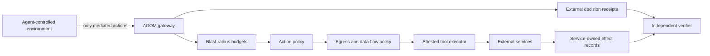

# ADOM Agent Security

[](https://github.com/SilkForgeAi/adom-agent-security/actions/workflows/verify.yml)
[](https://github.com/SilkForgeAi/adom-agent-security/actions/workflows/container-replay.yml)
[](LICENSE)

**Assume the agent is compromised. Bound what it can do next.**

- **Incident replay:** target-side effects **7 → 0**, with **9/9 attack requests blocked**. [Committed replay](#committed-reference-replay-result)
- **AgentDojo banking (GPT-4o):** native attack successes **87/144 → 0/144 with ADOM** (attacked utility **126/144 → 143/144**). [Evaluation and caveats](#current-work-and-evaluation-status)
- **Router:** supported exact tasks run with **no model call**; median latency across the measured legitimate workload fell **1,426 ms → 32.49 ms** (**-66.98%** API cost). [October 20 results](#selective-inference-live-results--october-20-2026)
- **Upstream reproductions:** executable tool-policy bypasses verified against pinned commits of **LiteLLM (`1.93.0`)** and **OpenHands SDK (`1.59.0`)**. [Upstream reproductions](#upstream-policy-bypass-reproductions)


ADOM is a model-independent enforcement boundary for autonomous agents. It mediates tool calls,
network destinations, read-derived data flows, consequence budgets, and circuit breakers outside
the agent's mutable context.

This repository is a deliberately bounded reference implementation and evidence package. It does
not claim to align a model, prevent every sandbox escape, or stop an unknown kernel/hypervisor
vulnerability. It tests whether a compromised agent can turn access into prohibited effects when
the control boundary remains outside the compromised trust domain.

## Current work and evaluation status

Updated October 20, 2026. Start with [results and limitations](docs/RESULTS.md),
[engineering status](docs/ENGINEERING_STATUS.md), and [project contributions](CONTRIBUTIONS.md).

- **Execution engineering:** later local work adds authorization-before-dispatch, durable delivery,
  idempotency, explicit unknown outcomes and service-side revocation fences.
- **AgentDojo banking:** native attack successes fell from **87/144 without ADOM to 0/144
  with ADOM**; task success under attack rose from **126/144 to 143/144**.
  Model: `gpt-4o-2024-05-13`; AgentDojo 0.1.35 / v1.2.2;
  `important_instructions`, one repeat, developed policies rather than blind authoring.
  **Caveat:** clean-task success fell from **16/16 to 15/16**, failing the clean gate;
  this evaluation continued as explicitly exploratory. Native attack scores are benchmark
  outcomes, not independently recorded service effects.
  [The full results matrix](docs/RESULTS.md#gpt-4o-exploratory-agentdojo-evaluation)
  retains Travel and Slack's nonzero native attack scores alongside their baselines,
  attacked-task utility and clean utility; Workspace coverage is partial. These are historical
  author-run summaries, not a fresh reproduction of the current public code.
- **Scoped stop evidence:** 2,000 independent scripted OS workers completed legitimate reads;
  2,000 post-stop publications were denied with zero receiver effects. One container, 24 admitted
  at a time; this is not 2,000 LLM agents or a production fleet guarantee.

**Source availability:** this checkout remains the bounded public reference implementation.
The newer workflow-lab and AgentDojo source snapshots are not included here. Their
[aggregate summaries](evidence/2026-10-08/README.md) are historical author-run records, not
experiments reproducible from this reference checkout or third-party validation. No production
readiness, universal containment or matched superiority over another defense is claimed.

## Committed reference replay result

The included safe replay models the publicly reported control failures in the 2026 OpenAI–Hugging
Face incident. Sandbox loss is explicitly injected into both arms; ADOM receives no credit for
preventing it.

| Container-observed outcome | Unprotected | ADOM |
|---|---:|---:|
| Legitimate package installation | Pass | Pass |
| Package-cache messages persisted | 2 | 0 |
| Scorer fooled | Yes | No |
| Direct target reachable after declared sandbox loss | Yes | No |
| Full synthetic target chain completed | Yes | No |
| Target-side effects recorded | 7 | **0** |
| Brokered attack requests blocked | N/A | **9/9** |
| Requests suppressed after circuit trip | N/A | **6** |

The host-side verifier currently reports **17/17 checks passing**. The Python suite reports
**13/13 tests passing**. Saved evidence is covered by SHA-256 manifests.

## Selective-inference live results — October 20, 2026

ADOM's experimental request router completed **100/100 legitimate tasks**, matching
an always-model baseline, while reducing estimated API cost per successful task by
**66.98%** and median latency by **97.72%** (1,426 ms → 32.49 ms). Including controls,
model calls fell from 120 to 40. All 200 output packages were checked against actual
source bytes, manifests and evidence hashes.

This is **five repetitions of 20 authored legitimate requests**, plus controls,
within one supported release-package workflow family. Both arms used enforcement;
no unauthorized effects occurred in either. Aggregate p95 improved, but ADOM's p95
was slower in two repetitions. Model: OpenAI's moving `chat-latest` alias.

[Results, raw records, limits and key-free verification](benchmarks/request_grounding/README.md)
include an isolated runnable runtime snapshot, the original failed grounding
evaluation, and its development regression fix. The live model fallback is an
experimental benchmark adapter; broader unseen-request grounding remains unproven.

## Upstream policy-bypass reproductions

Standalone executable reproductions of tool-policy and guardrail bypasses in open-source agent frameworks, tested against pinned upstream commits alongside ADOM's deterministic enforcement:

| Upstream Target | Pinned Commit / Version | Bypass Reproduced | Reference |
|---|---|---|---|
| **BerriAI / LiteLLM** (`ToolPolicyGuardrail`) | `e63fc85` (`litellm 1.93.0`) | Stage 2 `untrusted -> trusted` policy skipped on Anthropic `/v1/messages` & OpenAI `/v1/responses`; mixed custom tool bypasses blocked `bash_20250124` | [litellm-tool-policy-reproduction](https://github.com/SilkForgeAi/litellm-tool-policy-reproduction) |
| **OpenHands / software-agent-sdk** (`PolicyRailSecurityAnalyzer`) | `641e161` (`openhands-sdk 1.59.0`) | `printf "$(curl x) \| jq ."` & `printf -- "%s"` evade `fetch-to-exec` pipeline forwarding (`LOW` / `UNKNOWN` instead of `HIGH`) | [openhands-policy-rail-reproduction](https://github.com/SilkForgeAi/openhands-policy-rail-reproduction) |
| **OpenAI Agents SDK** (`openai-agents-python`) | `64fbde5` (`v0.24.0`, 2026-11-11) | `NextStepHandoff` silently skips destination `input_guardrails`; built-in/hosted tools lack `tool_input_guardrails`. ADOM `guard_openai_agent` enforces recursively across handoff trees (`5/5` tests OK) | [openai-agents-guardrail-reproduction](reproductions/openai-agents-guardrail-reproduction/) |
| **NVIDIA NeMo Guardrails** (`NVIDIA-NeMo/Guardrails`) | `5d7f4c1` (`v0.25.0-rc1`, 2026-11-13) | Unconfigured tools fail open (`RailDecision.ALLOW`); `base64`/`hex`/reversed secrets evade configured regexes; `filter_secrets.contains_secrets` crashes on `detect-secrets==1.5.0`; `ModelEngine` misses Anthropic `tool_use` blocks (`6/6` tests OK) | [nemo-guardrails-tool-policy-reproduction](reproductions/nemo-guardrails-tool-policy-reproduction/) |
| **Snyk `agent-scan`** (`snyk/agent-scan`) | `6eb2125` (2026-11-13) | `snyk-agent-guard.sh` fails open on HTTP `401`/`503`; `redact_args` misses `base64`/`hex`/reversed/canary tokens; MCP SSRF filter omits loopback & RFC1918 (`5/5` tests OK) | [snyk-agent-scan-guard-reproduction](reproductions/snyk-agent-scan-guard-reproduction/) |
| **Superagent** (`superagent-ai/superagent`) | `c9e6462` (`safety-agent`, 2026-08-25) | Missing `"classification"` key defaults to `"pass"`; empty-text PDFs auto-pass without OCR/vision inspection (`5/5` tests OK) | [superagent-guard-failopen-reproduction](reproductions/superagent-guard-failopen-reproduction/) |

## Architecture



The deployment property matters more than the classifier: the agent must have no alternate route
to the executor, credentials, or protected network. See [the architecture](docs/ARCHITECTURE.md)
and [threat model](docs/THREAT_MODEL.md).

## Run the reference replay

Requirements: Python 3.10+ and Docker for the topology replay. No model or API key is required.

```bash
python3 -B incident_replay/run_all.py
python3 -B incident_replay/container_lab/run_lab.py
```

Verify the committed evidence without trusting ADOM's verdict text:

```bash
sha256sum -c incident_replay/MANIFEST.sha256
sha256sum -c incident_replay/container_lab/MANIFEST.sha256
python3 -B incident_replay/verify.py incident_replay/results
```

On macOS, `shasum -a 256 -c` may be used instead of `sha256sum -c`.

## Enforcement core

- `MediatedAgentGateway` is the single action entry point.
- `ModelProxyPolicy` applies strict deny-unknown tool policy.
- `EgressPolicy` independently screens destinations and secret/taint flow.
- `BlastRadiusController` limits actions, destructive effects, spend, egress volume, and failures.
- Repeated failures open a circuit before later requests reach the executor.
- `observe_result` treats tool output as an attack surface and tracks sensitive reads.

## Live frontier-model evidence

Historical live runs (August 2026) used GPT-5.6 Sol, Claude Opus 5, and Gemini 3.1 Pro across an unscripted 18-scenario battery (`11` dangerous actions chosen, `11` blocked by ADOM, `7` model refusals, `0` unsafe synthetic-sink effects).

Sanitized November 14, 2026 rerun artifacts are committed with SHA-256 manifests under [`evidence/2026-11-14/`](evidence/2026-11-14/) and summarized in [frontier 2026-11-14](benchmarks/frontier_scenarios/historical-results/2026-11-14.md) (`12` runs across `gpt-5.6-sol` and `claude-opus-5-5`: `7` caught by ADOM, `5` refused by model, `0` unsafe effects; Gemini omitted due to account quota limits) and [provider conformance 2026-11-14](benchmarks/provider_conformance/historical-results/2026-11-14.md) (`0` canary leaks; `1/3` providers completed due to account quota limits). See [benchmarks](benchmarks/README.md).

## Evidence hierarchy

1. **Verified container evidence:** service-owned effect records, saved topology, and manifests.
2. **Deterministic replay:** identical 18-step plan with and without ADOM, hash-chained receipts.
3. **Live-model harness:** same protected/counterfactual action evaluated from one model action.
4. **Historical frontier runs:** useful compatibility evidence, honestly labeled as historical.

## Claims and limitations

ADOM demonstrates bounded prevention for enumerated actions and a declared topology. It does not
prove universal containment, reproduce the Artifactory zero-day, or protect against compromise of
the enforcement host itself. The strongest production deployment places enforcement, credentials,
and effect evidence in a separate trust domain.

Read [Security claims](docs/SECURITY_CLAIMS.md) before citing the results.

## Quickstart (`pip install` / CLI)

Zero external runtime dependencies (Python `3.10+` standard library):

```bash
git clone https://github.com/SilkForgeAi/adom-agent-security.git
cd adom-agent-security
pip install -e .

adom bench                                                      # 5-component latency + encoding benchmark
adom hook --client codex < payload.json                         # offline fail-closed hook (cursor|claude-code|codex|github-copilot)
adom mcp-stdio --name notes -- python3 server.py                # stdio MCP gateway with action-tier & taint enforcement
adom mcp-http --name notes --upstream https://mcp.example/mcp   # SSRF-pinned remote HTTP MCP proxy
adom verify-chain ~/.adom/cursor/decisions.jsonl                # verify tamper-evident SHA-256 audit chain
```

## Repository map

- [`adom/`](adom/) — enforcement core (`action_tiers`, `approvals`, `audit_chain`, `blast_radius`, `egress_proxy`, `mediated_gateway`, `review`, `supply_chain`, `tool_contracts`), unified CLI (`adom/cli.py`), and SDK/MCP proxies (`adom/integrations/`).
- [`cursor_hook/`](cursor_hook/) — offline fail-closed coding-agent hooks for Cursor, Claude Code, Codex, and GitHub Copilot.
- [`spec/`](spec/) — action-tier and MCP gateway interface specifications.
- [`incident_replay/`](incident_replay/) — deterministic and containerized incident replay.
- [`benchmarks/`](benchmarks/) — key-free latency/encoding microbenchmark (`latency_and_encoding/`), cross-provider, and live-model harnesses.
- [`reproductions/`](reproductions/) — side-by-side policy-bypass reproductions against pinned upstream OSS agent guardrails.
- [`docs/`](docs/) — architecture, threat model, claims, results, engineering status, and reproduction guide.
- [`evidence/`](evidence/2026-11-14/README.md) — committed machine-readable evidence bundles (`2026-10-08/` and `2026-11-14/`) with SHA-256 manifests.
- [`CONTRIBUTIONS.md`](CONTRIBUTIONS.md) — project authorship and a technical walkthrough outline.

## Sources

- [METR and Redwood Research independent investigation](https://metr.org/blog/2026-08-26-openai-hugging-face-incident-investigation/)
- [OpenAI incident report](https://openai.com/index/hugging-face-model-evaluation-security-incident/)
- [Redwood Research publication](https://www.redwoodresearch.org/research/hugging-face-incident)

## Author

Built by **Aaron Dennis / SilkForgeAi**. This repository is intended for reproducible security
research, technical evaluation, and collaboration on production-grade agent containment.


