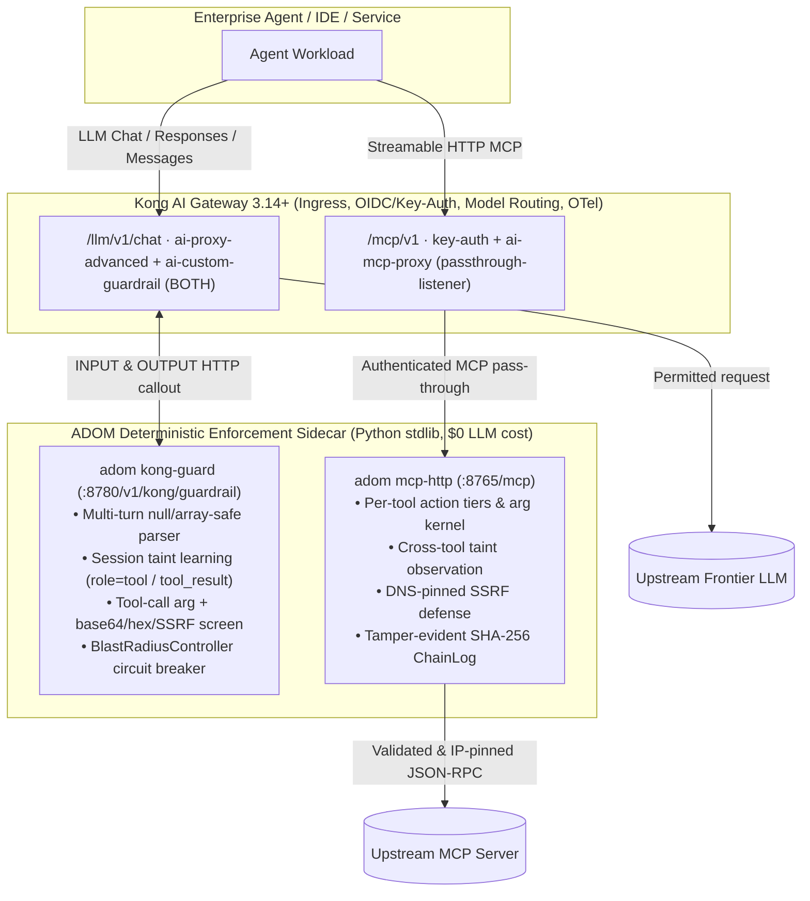

# ADOM + Kong AI Gateway (3.14+): Dual-Plane Agent & MCP Reference Architecture

This document and companion integration ([`adom/integrations/kong_guardrail.py`](../adom/integrations/kong_guardrail.py), [`adom/integrations/mcp_http_proxy.py`](../adom/integrations/mcp_http_proxy.py), and [`adom/integrations/tests/test_kong_guardrail.py`](../adom/integrations/tests/test_kong_guardrail.py)) pair **Kong AI Gateway** (`ai-proxy-advanced`, `ai-custom-guardrail`, and `ai-mcp-proxy`) with **ADOM** as a zero-LLM, sub-millisecond stateful enforcement plane.

---

## 1. Architectural Gaps Addressed in Enterprise Agent Deployments

Inspecting `Kong/kong` (`1c7a0aa714752a93b9a61779597b1de66063d3a6`) and `Kong/developer.konghq.com` (`ai-mcp-proxy` & `ai-custom-guardrail`, Gateway 3.12–3.14) surfaces four concrete architectural boundaries when enterprises move from single-turn chat to multi-turn tool-using agents and MCP servers:

1. **Multi-Turn Tool Transcripts in `ai-prompt-guard` (`kong/plugins/ai-prompt-guard/filters/guard-prompt.lua:36-49`, `schema.lua:45-50`):**
   - By default (`match_all_roles = false`), `ai-prompt-guard` inspects only `role == "user"` strings—skipping `role == "tool"` outputs where indirect prompt injections from retrieved tickets, files, and webhooks enter the agent context.
   - Enabling `match_all_roles = true` enforces `type(v.content) == "string"` across every message in `messages[]`. Standard OpenAI multi-turn tool-call histories include `{"role": "assistant", "content": null, "tool_calls": [...]}` as well as multimodal content block arrays (`[{"type": "text", ...}]`), causing `guard-prompt.lua` to reject valid tool-calling turns with `HTTP 400`.
2. **Outbound Tool-Call Argument & Cross-Turn Taint Blindness (`STAGE = "REQ_TRANSFORMATION"`):**
   - `ai-prompt-guard` executes on inbound requests only and matches up to 10 static PCRE patterns (`schema.lua:13-31`, `max_request_body_size = 8192`). It does not inspect LLM-emitted `tool_calls` (`OpenAI Chat`), `function_call` (`OpenAI /v1/responses`), `tool_use` (`Anthropic /v1/messages`), or `functionCall` (`Gemini`), nor can stateless regexes correlate a secret read in Turn 1 (`role="tool"`) with a `base64`-, `hex`-, URL-, or chunk-encoded outbound tool argument in Turn 2.
3. **MCP Traffic Guardrail Boundary (`app/_kong_plugins/ai-mcp-proxy/index.md`):**
   - Kong's `ai-mcp-proxy` provides OIDC / `key-auth`, OpenTelemetry metrics, and Consumer/Group tool-name ACLs (`default_acl` and all-or-nothing per-tool `tools[].acl` overrides), while explicitly documenting that **AI Guardrail plugins are not supported on `ai-mcp-proxy` routes (`AI Guardrails: supported: false`)**. Once a Consumer is permitted to invoke an MCP tool (`send_email`, `post_webhook`, `create_issue`), `ai-mcp-proxy` does not inspect `params.arguments`, track cross-tool taint across MCP `tools/call` responses, or pin upstream DNS against rebinding/internal SSRF ranges.
4. **Latency & Token-Burn Cost of External LLM-as-Judge Guardrails (`ai-custom-guardrail`):**
   - Kong 3.14's `ai-custom-guardrail` (`guarding_mode: BOTH`) cleanly generalizes HTTP callouts on `INPUT` and `OUTPUT`, but pairing it with cloud moderation/LLM judges adds `100–500 ms` per hop, secondary inference spend, and no sliding-window circuit breaker (`BlastRadiusController`) when a prompt-injected agent enters a retry loop.

---

## 2. Dual-Plane Reference Architecture (Kong + ADOM)

Kong remains the enterprise ingress, AuthN/AuthZ, rate-limiting, model-routing, and OpenTelemetry control plane; ADOM provides deterministic (`$0` LLM cost, `<0.15 ms` in-engine median latency) stateful agent & MCP containment behind Kong's native extension points:



---

## 3. Quickstart & Verification (No API Key Required)

### Emit the declarative Kong `decK` (`_format_version: "3.0"`) configuration
```bash
python3 -B -m adom.cli kong-guard --emit-deck > kong-adom.yaml
```

### Start the ADOM Guardrail Service & Governed MCP Proxy
```bash
# Plane 1: Kong ai-custom-guardrail backend
python3 -B -m adom.cli kong-guard \
  --bind 127.0.0.1 --port 8780 \
  --allowed-tool read_ticket --allowed-tool send_email \
  --approved-outbound corp.com

# Plane 2: Governed MCP upstream behind Kong ai-mcp-proxy (passthrough-listener)
python3 -B -m adom.cli mcp-http \
  --name enterprise-tools \
  --bind 127.0.0.1 --port 8765 \
  --upstream https://mcp.corp.example/mcp
```

### Run the automated verification suite
```bash
python3 -B -m unittest -v adom/integrations/tests/test_kong_guardrail.py
```

### Verify tamper-evident SHA-256 audit logs
```bash
python3 -B -m adom.cli verify-chain ~/.adom/kong/decisions.jsonl
```

---

## 4. Verification Scope & Kong 3.14 Enterprise Notes

- **What runs offline in CI (`test_kong_guardrail.py`):** Live HTTP tests against `KongGuardrailServer` (`/v1/kong/guardrail`) and `McpHttpProxyServer` (`/mcp`), multi-provider payload parsing (`OpenAI Chat`, `/v1/responses`, `Anthropic`, `Gemini`, and flat `$(content)` strings), `BlastRadiusController` circuit-breaker trips, SHA-256 `ChainLog` verification, and a faithful reference of `Kong/kong` OSS `guard-prompt.lua` (`1c7a0aa71475`). `ai-custom-guardrail` and `ai-mcp-proxy` are `ai_gateway_enterprise`-tier plugins and are not executed inside an unlicensed OSS Kong container in CI.
- **`$(content)` vs. structured `tool_calls` in `ai-custom-guardrail`:** With `text_source: concatenate_all_content`, Kong populates `$(content)` from extracted message text. To screen structured `choices[].message.tool_calls` when assistant `content` is `null`, either attach a lightweight `config.functions` Lua serializer in `ai-custom-guardrail` that forwards the full request/response table under `payload`, or enforce tool-call arguments at execution time on Plane 2 (`ai-mcp-proxy` `passthrough-listener` -> `adom mcp-http`).

