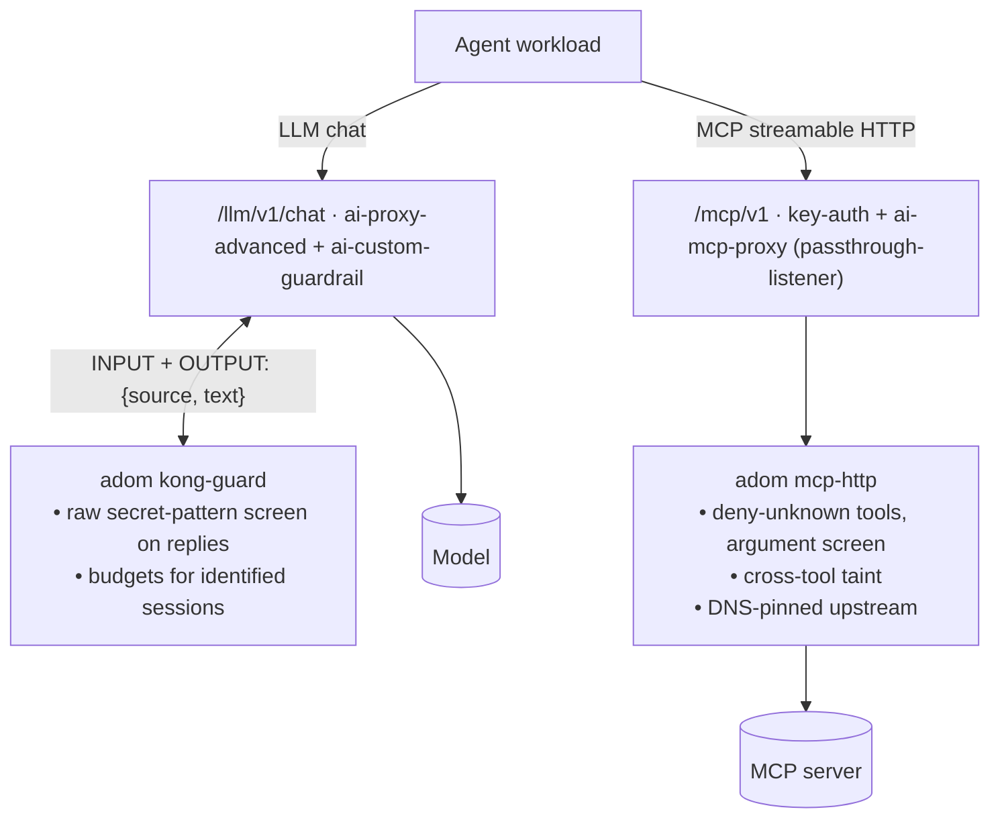

# ADOM with Kong AI Gateway: what it does, what was verified, what it does not do

Companion code: [`adom/integrations/kong_guardrail.py`](../adom/integrations/kong_guardrail.py)
(LLM plane), [`adom/integrations/mcp_http_proxy.py`](../adom/integrations/mcp_http_proxy.py)
(MCP plane), tests in [`adom/integrations/tests/`](../adom/integrations/tests/), real-Kong smoke
test in [`deployment/kong-konnect-smoke/`](../deployment/kong-konnect-smoke/).

## Status (November 19, 2026)

| Plane | Kong plugin → ADOM | Verified on real Kong? |
|---|---|---|
| LLM | `ai-custom-guardrail` → `adom kong-guard` | **Yes**: Kong Gateway Enterprise 3.16 data plane via a Konnect trial, mock model, non-streaming calls. [`evidence/2026-11-19/`](../evidence/2026-11-19/README.md) |
| MCP | `ai-mcp-proxy` (`passthrough-listener`) → `adom mcp-http` | **No**: tested in CI against a fake MCP server shaped like the official SDK server, not yet behind Kong |

## LLM plane: what ADOM can and cannot see

Kong calls ADOM before the request goes to the model (INPUT) and after the reply comes back
(OUTPUT). With the generated config, every call on real Kong carried exactly
`{"source": "INPUT"|"OUTPUT", "text": ...}`. `text` is `$(content)`: with
`text_source: concatenate_all_content` it joins message text newest first, including
`role: "tool"` messages, and leaves out structured tool calls. Kong sent no caller identity.

**Blocked, as shipped by `adom kong-guard`:** a model reply containing a raw secret-shaped
string: AWS access keys, `sk-` API keys, private-key headers, GitHub and Slack tokens,
`password=`/`secret:` pairs. On real Kong this returned 400 and the secret never reached the
client.

**Not blocked on this plane:**
- **Tool calls in the reply.** For a reply that was only a tool call, Kong made no OUTPUT call
  to ADOM at all, so no guardrail config can stop it here. Enforce tool calls where they
  execute: the MCP plane below, or ADOM's in-process tool guards.
- **Encoded secrets** (base64, hex, reversed). ADOM decodes and matches values it knows are
  secret (taints). `adom kong-guard` has no option to supply them, and ADOM cannot learn them
  here: tool output reaches it on INPUT merged with user text and unlabeled. Verified on real
  Kong: a secret read by a tool and echoed back base64 reached the client.
- **Anything in the request.** INPUT calls are allowed as shipped (no deny patterns are set).
  ADOM does not do semantic prompt-injection detection.
- **PII.** ADOM flags PII only after a sensitive read, which this plane never registers.

**Budgets and circuit breaker:** off unless the caller is identified. Kong sends no identity,
so every call is an unidentified session, and one breaker shared by all callers would let one
caller's failures, or 200 ordinary calls a minute, block the whole gateway (both measured
on the earlier shared-session design; tests now check neither happens). Identify callers with `adom kong-guard --emit-deck --session-scope <name>`, which
sends `X-Session-Id` through `$(conf.params.adom_session_scope)` (one identity per plugin
instance; scope the plugin to a consumer for per-consumer budgets), or use
`--anonymous-blast-radius` on a single-tenant gateway.

**Failure handling:** the generated config sets `stop_on_error: true` (Kong stops the request
if the guardrail call fails; also Kong's default) and `ssl_verify: true` (Kong's default is
false, which would call an `https` guardrail without checking its certificate). ADOM answers
"block" on its own internal errors.

**Latency:** the decision inside ADOM measured 0.004–0.105 ms median and up to 0.19 ms at p99
(in-process, Linux, 2026-11-19), excluding the network hop between Kong and ADOM.

## MCP plane: `ai-mcp-proxy` → `adom mcp-http` → your MCP server

`adom mcp-http` denies tools nobody has classified (operator registry
`~/.adom/tool_tiers.json`), screens arguments with ADOM's kernel (secrets, encoded taint,
unapproved destinations), blocks credential paths in `resources/read` and `prompts/get`,
learns taint from tool, resource and prompt results, and dials a DNS-pinned upstream with TLS
verification. It speaks MCP streamable HTTP (JSON and SSE replies, session ids, 202
notification acks) and refuses servers that need to send requests to the client mid-call
(sampling, elicitation). `adom mcp-http` does **not** write an audit log; the stdio gateway
(`adom mcp-stdio`) does.

Kong's docs say not to put `ai-mcp-proxy` on the same service or route as other AI plugins;
the generated config keeps the two planes on separate services.

## Kong behaviors this relies on

Checked against Kong's open-source repository (`Kong/kong` at
`1c7a0aa714752a93b9a61779597b1de66063d3a6`, 2026-11-17) and Kong's documentation.

| Kong behavior | Source |
|---|---|
| `ai-prompt-guard` checks only `role: "user"` messages by default; with `match_all_roles: true` every message must have string content, so an assistant turn with `content: null` and `tool_calls` is rejected with HTTP 400 | `kong/plugins/ai-prompt-guard/filters/guard-prompt.lua` lines 48–65, 125–139; `schema.lua` lines 40–44 |
| `ai-prompt-guard` runs on requests only (`STAGE = "REQ_TRANSFORMATION"`), takes at most 10 allow and 10 deny patterns, and introspects up to 8 KiB by default | `guard-prompt.lua` line 7; `schema.lua` lines 10–39 |
| `ai-custom-guardrail` template variables are `$(source)`, `$(conf…)`, `$(content)`, `$(resp…)`; `$(content)` is extracted text, not the full body | Kong plugin docs, developer.konghq.com/plugins/ai-custom-guardrail |
| `ai-custom-guardrail` config fields and defaults (`stop_on_error` true, `ssl_verify` false, `timeout` 10000 ms, `response_buffer_size` 100 bytes for response guarding, `metrics.block_detail`) | Konnect provider schema reference; pinned by `KongSchemaConformanceTests` |
| Kong's own AI guardrails do not apply to `ai-mcp-proxy` traffic. Partner plugins can inspect MCP tool input on Kong (for example CrowdStrike Falcon AIDR MCP, which runs before `ai-mcp-proxy`) | Kong `ai-mcp-proxy` and partner plugin docs |

## How this compares (no head-to-head testing has been done)

- **`ai-prompt-guard`:** ADOM checks replies as well as requests and sees tool-output text that
  `ai-prompt-guard` skips by default. `ai-prompt-guard` blocks request patterns, which ADOM's
  shipped Kong config does not.
- **LLM-judge guardrails through `ai-custom-guardrail`:** ADOM makes no model call and its
  verdicts are deterministic. A judge can catch meaning that pattern matching cannot.
- **Partner MCP plugins:** ADOM runs locally, is deterministic, and tracks taint across tools in
  a session. It has not been compared against them.

## Architecture



## Quickstart

```bash
adom kong-guard --emit-deck > kong-adom.yaml          # add --session-scope <name> for budgets
adom kong-guard --bind 127.0.0.1 --port 8780 \
  --allowed-tool read_ticket --allowed-tool send_email --approved-outbound corp.com
adom mcp-http --name enterprise-tools --bind 127.0.0.1 --port 8765 \
  --upstream https://mcp.corp.example/mcp
adom verify-chain ~/.adom/kong/decisions.jsonl         # kong-guard's audit chain
```

## Verification and what is not yet tested

- **CI:** `test_kong_guardrail.py` runs the guardrail and MCP proxy servers over HTTP, parses
  OpenAI Chat, Responses, Anthropic, Gemini and flat-text payloads, checks breaker behavior,
  audit-chain verification, the decK config against Kong's schema and documented variables,
  and a Python reimplementation of the logic in Kong's `guard-prompt.lua`. Kong itself does not run in CI:
  `ai-custom-guardrail` and `ai-mcp-proxy` are AI Gateway Enterprise plugins.
- **Real Kong:** `deployment/kong-konnect-smoke/run.sh` (needs Docker and a Konnect account).
  First run 2026-11-19: it caught a schema error (`metrics.block_details`, since fixed); the
  second run passed. Results and the exact requests Kong sent are in `evidence/2026-11-19/`.
- **Not tested yet:** the MCP plane behind Kong; streaming replies through Kong (with
  `response_buffer_size`, a secret split across buffered chunks might not match); more than
  one Kong data plane or ADOM process (budgets are per process).
