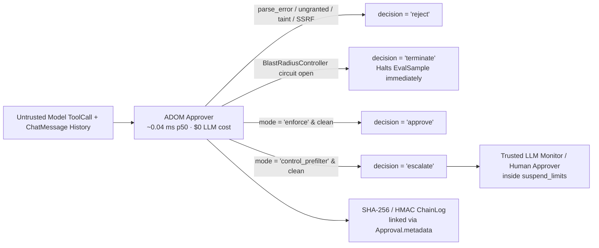

# ADOM × UK AISI Inspect (`inspect_ai`) — Stateful Containment & AI-Control Pre-Filter

This document details how ADOM integrates natively with the UK AI Security Institute's [`inspect_ai`](https://github.com/UKGovernmentBEIS/inspect_ai) `Approver` architecture for agentic security benchmarks (`MCPTox`, `b3`, `AgentHarm`, `AgentDojo`) and two-stage **AI Control** monitor evaluations.

---

## 1. Architectural Seams Identified in `inspect_ai` (`src/inspect_ai/approval/`)

Tracing `UKGovernmentBEIS/inspect_ai` (`_policy.py`, `_apply.py`, and `_tool_call.py`) highlights four concrete gaps when evaluating untrusted tool-using or MCP-connected agents:

1. **Stateless Glob Matching Ignores `history: list[ChatMessage]` Taint (`_policy.py:137-155`):**
   - Built-in `ApprovalPolicy` rules compile `tools` and `arguments` into single-turn `fnmatch` predicates (`auto` / `human`). Even though `Approver.__call__(message, call, view, history)` receives the full `ChatMessage` transcript, Inspect ships no deterministic runtime `Approver` that ingests `ChatMessageTool` outputs from earlier turns to block cross-turn raw, `base64`, `hex`, URL-encoded, or reversed secret exfiltration.
2. **Unbudgeted Monitor Amplification Inside `suspend_limits()` (`_apply.py:62-66`):**
   - `apply_tool_approval` executes approvers inside `with suspend_limits(), sentinel_scope("approval", final=True):` so LLM-monitor tokens and wall-clock time are intentionally excluded from the evaluated agent's sample budget.
   - Consequence for **AI Control** evaluations: an untrusted or prompt-injected model that enters a retry loop against a trusted LLM monitor triggers unbounded monitor API calls and latency outside sample limits unless a `$0`, sub-`0.1 ms` deterministic pre-filter + sliding-window circuit breaker sits upstream and emits `decision="terminate"` when failure thresholds trip.
3. **Implicit Prefix-Glob Expansion & Named-Argument Fallthrough (`_policy.py:124, 143`):**
   - In `tool_call_matcher`, any tool name without glob characters (`*`, `?`, `[`) is compiled to `f"{function}*"` (`tools="read_note"` silently matches `read_note_and_export`).
   - Argument policies (`arguments={"url": "*"}`) check `name in call.arguments` on top-level keys only; nested structures (`{"target": {"url": ...}}`) or alternate parameter names skip the rule.
4. **Malformed `ToolCall.parse_error` Pass-Through (`_tool_call.py:48`):**
   - `ToolCall` carries `parse_error: str | None` when model tool-call JSON fails parsing, yet `ApprovalPolicy` still evaluates `matches(call)` over partial/empty `call.arguments` unless an approver explicitly fails closed on `parse_error`.

---

## 2. Two-Stage AI Control & Standalone Containment Topology



### Deployment Modes (`adom/integrations/inspect_approver.py`)

| Mode | Clean Verdict | Policy Violation | Circuit-Breaker Trip (`BlastRadiusController`) | Primary Use Case |
|---|---|---|---|---|
| `enforce` | `approve` | `reject` | `terminate` | Zero-LLM deterministic containment on `MCPTox`, `b3`, `AgentHarm`, `AgentDojo` |
| `control_prefilter` | `escalate` | `reject` | `terminate` | Stage-1 shield ahead of trusted LLM/human monitors in AI Control protocols |
| `observe` | `approve` *(logs `adom_would_block`)* | `approve` *(logs `adom_would_block`)* | `approve` *(logs `adom_breaker_tripped`)* | Shadow telemetry & false-positive auditing across benign eval splits (`agentharm_benign`) |

---

## 3. Quickstart with `inspect eval`

`pyproject.toml` registers `adom_agent_security` under `[project.entry-points.inspect_ai]` while keeping `adom-agent-security`'s core runtime 100% Python `3.10+` standard library.

```bash
pip install -e .

# Generate a standalone enforcement policy or a 2-stage AI-Control prefilter policy:
adom inspect-policy --mode enforce > adom-enforce.yaml
adom inspect-policy --mode control_prefilter --downstream-approver human > adom-control.yaml

# Run with UK AISI Inspect:
inspect eval inspect_evals/b3 --approval adom-enforce.yaml
inspect eval inspect_evals/mcptox --approval adom-control.yaml
```

Every `Approval` returned by ADOM records `adom_signals`, `adom_latency_ms`, `adom_audit_seq`, and `adom_audit_hash` in `Approval.metadata`, linking Inspect's `.eval` `ApprovalEvent` log directly to an external tamper-evident `ChainLog` verifiable via `adom verify-chain`.

---

## 4. Scope & Honest Research Limits

- **Deterministic capability & taint enforcement vs. open-ended semantic intent:** ADOM deterministically blocks ungranted tools, SSRF/unallowlisted destinations, shell/credential-path escapes, raw/encoded cross-turn secret exfiltration, and runaway retry cascades at `$0` inference cost. Same-capability semantic misuse inside an authorized tool with untainted arguments (e.g., selecting the wrong item ID in an allowed shopping tool, documented in `docs/RESULTS.md` at `6/180` on unseen `AgentDyn` `shopping`) still requires either task-compiled contracts or Stage-2 escalation (`mode="control_prefilter"`) to a trusted semantic monitor.
- **In-process approval boundary:** Like all `inspect_ai` `Approver` plugins, `adom_approver` mediates tool calls routed through `apply_tool_approval`. Sandbox-level network containment inside Docker/K8s task environments should additionally pair Inspect's `SandboxEnvironment` network isolation with `adom/enforcement/egress_proxy.py` (`resolve_and_pin`).
