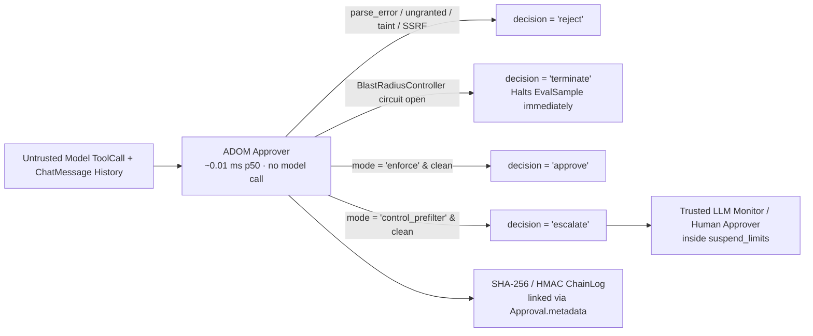

# ADOM × UK AISI Inspect (`inspect_ai`): approver and AI-Control pre-filter

This document describes ADOM's approver for the UK AI Security Institute's [`inspect_ai`](https://github.com/UKGovernmentBEIS/inspect_ai) approval system and its use as a deterministic first stage in front of an LLM or human monitor (AI Control set-ups).

**Status (2026-11-19):** checked against `inspect-ai==0.3.291`. Inspect's own loader
(`approval_policies_from_config`) loads the YAML that `adom inspect-policy` writes and resolves
`adom/adom_approver`. Through Inspect's `policy_approver`, ADOM approved granted calls and
rejected a base64-encoded secret read by an earlier tool, an unapproved destination, a
destructive call and an ungranted tool. The decision measured 0.011 ms median, 0.167 ms p99
(in-process). ADOM has **not** been run on any Inspect benchmark (b3, MCPTox, AgentHarm,
AgentDojo); the commands below show how it would be wired.

---

## 1. What Inspect's built-in approval does, and what ADOM adds

Checked against the `inspect_ai` 0.3.291 source.

1. **No cross-turn taint in the built-in approvers.** The built-ins are the auto, human and
   policy approvers (`approval/_auto.py`, `_human/`, `_policy.py`). Policy rules are
   single-call `fnmatch` predicates over the tool name and arguments (`tool_call_matcher`,
   `_policy.py` lines 60–151). Approvers receive the conversation `history`, but none of the
   built-ins tracks secrets read by earlier tools. ADOM learns them from `ChatMessageTool`
   outputs and blocks raw and encoded copies in later calls.
2. **Approval runs outside the sample's limits** (`approval/_apply.py` lines 62–76). Inspect runs
   approvers inside `suspend_limits()` by design, so an LLM monitor's tokens and time are not
   charged to the agent. The number of approvals is still bounded by the agent's own limits, but
   monitor cost per call is not. ADOM's breaker can return `terminate` after repeated violations,
   and in `control_prefilter` mode it rejects deterministic violations before a monitor is called.
3. **Name and argument matching.** A tool name without glob characters becomes a prefix glob
   (`_policy.py` line 121: `f"{function}*"`), so `tools: "read_note"` also matches
   `read_note_and_export`. Argument rules test `name in call.arguments` on top-level keys only
   (line 139), so a value nested under another key does not match the rule. ADOM grants exact
   tool names and scans every argument value.
4. **Malformed tool calls are not a gap in 0.3.291.** Inspect raises on `ToolCall.parse_error`,
   unknown tools and schema-invalid arguments before approval (`model/_call_tools.py`
   lines 954–985), so approvers never see them. ADOM's own fail-closed check on `parse_error`
   remains as defense in depth for other callers.

---

## 2. Two-Stage AI Control & Standalone Containment Topology



### Deployment Modes (`adom/integrations/inspect_approver.py`)

| Mode | Clean Verdict | Policy Violation | Circuit-Breaker Trip (`BlastRadiusController`) | Primary Use Case |
|---|---|---|---|---|
| `enforce` | `approve` | `reject` | `terminate` | Deterministic containment with no model call (not yet run on any Inspect benchmark) |
| `control_prefilter` | `escalate` | `reject` | `terminate` | Stage-1 shield ahead of trusted LLM/human monitors in AI Control protocols |
| `observe` | `approve` *(logs `adom_would_block`)* | `approve` *(logs `adom_would_block`)* | `approve` *(logs `adom_breaker_tripped`)* | Shadow telemetry & false-positive auditing across benign eval splits (`agentharm_benign`) |

---

## 3. Quickstart with `inspect eval`

`pyproject.toml` registers `adom` under `[project.entry-points.inspect_ai]` while keeping `adom-agent-security`'s core runtime 100% Python `3.10+` standard library (and includes an alias workaround for `inspect_ai._util.package.package_is_installed_editable` when distribution name `adom-agent-security` differs from top-level import package `adom`).

```bash
pip install -e .

# Generate a standalone enforcement policy or a 2-stage AI-Control prefilter policy:
adom inspect-policy --mode enforce > adom-enforce.yaml
adom inspect-policy --mode control_prefilter --downstream-approver human > adom-control.yaml

# Run with UK AISI Inspect (task names depend on your inspect_evals version; not yet run by ADOM):
inspect eval inspect_evals/b3 --approval adom-enforce.yaml
inspect eval inspect_evals/mcptox --approval adom-control.yaml
```

Every `Approval` returned by ADOM records `adom_signals`, `adom_latency_ms`, `adom_audit_seq`, and `adom_audit_hash` in `Approval.metadata`, linking Inspect's `.eval` `ApprovalEvent` log directly to an external tamper-evident `ChainLog` verifiable via `adom verify-chain`.

---

## 4. Scope & Honest Research Limits

- **Deterministic capability & taint enforcement vs. open-ended semantic intent:** ADOM deterministically blocks ungranted tools, SSRF/unallowlisted destinations, shell/credential-path escapes, raw/encoded cross-turn secret exfiltration, and runaway retry cascades at `$0` inference cost. Same-capability semantic misuse inside an authorized tool with untainted arguments (e.g., selecting the wrong item ID in an allowed shopping tool, documented in `docs/RESULTS.md` at `6/180` on `AgentDyn` `shopping`) still requires either task-compiled contracts or Stage-2 escalation (`mode="control_prefilter"`) to a trusted semantic monitor.
- **In-process approval boundary:** Like all `inspect_ai` `Approver` plugins, `adom_approver` mediates tool calls routed through `apply_tool_approval`. Sandbox-level network containment inside Docker/K8s task environments should additionally pair Inspect's `SandboxEnvironment` network isolation with `adom/enforcement/egress_proxy.py` (`resolve_and_pin`).
